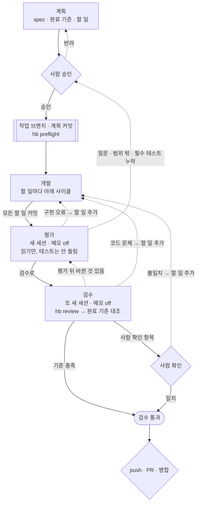
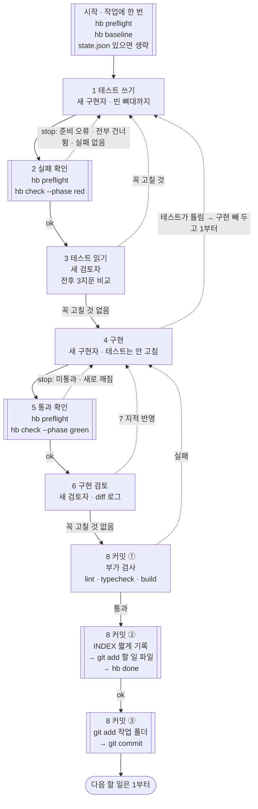

# hb 흐름 한눈에

사람이 보는 지도입니다. 규칙의 원본은 `skills/*/SKILL.md`이고, 이 문서와 다르면 스킬 문서가 맞습니다. 에이전트는 이 문서를 새로 쓰거나 고치지 않습니다.

모양: `{ }` 사람 · `[[ ]]` hb·git이 판정하고 기록 · `[ ]` AI(지휘·구현자·검토자·평가자·검수자) · 점선은 되돌아가는 길

평가와 검수는 사람이 새 세션을 열어 시작합니다. 저장소의 운용 정책(`.harness/README.md`)에서 지휘에게 맡길 수 있습니다.

## 단계

## 할 일 하나 (개발)

구현 검토는 모든 할 일에 합니다. 테스트가 틀리면 구현은 logs에 빼 두고 되돌린 뒤 1부터 다시 합니다. 1~3에서는 빼 둔 구현을 보지 않습니다. 완료 기준 문장이 바뀔 때만 사람 승인을 받습니다.

## 그림에 없는 것

- hb 판정(`ok`·`stop`·`not_run`·`timeout`)과 멈췄을 때 할 일: `skills/dev/SKILL.md`의 "프로그램 부르는 법"·"멈췄을 때", `skills/review/SKILL.md`의 "막혔을 때"
- 한도와 테스트 정정: `skills/dev/SKILL.md`의 "그 밖의 규칙", `skills/eval/SKILL.md`의 "다음 단계"
- 결제·권한·개인정보·DB 구조 변경, 실제 DB·운영 작업의 승인: `skills/plan/SKILL.md`의 "이번 판이 다루는 범위"
- 승인과 제안의 규칙(사람의 원문만, hb 안팎의 일은 따로): `skills/plan/SKILL.md`의 8번, `skills/dev/SKILL.md`의 "승인 기록"·"제안", `docs/hermes.md`, 그 저장소의 `.harness/README.md` 운용 정책
- 실행기별 부르는 법: `README.md`의 "쓰는 법 (Claude Code)", `docs/hermes.md`
- 저장소마다 다른 것(검사 환경, 부가 검사 명령, push·PR·병합, 배포 등): 그 저장소의 `.harness/README.md`
